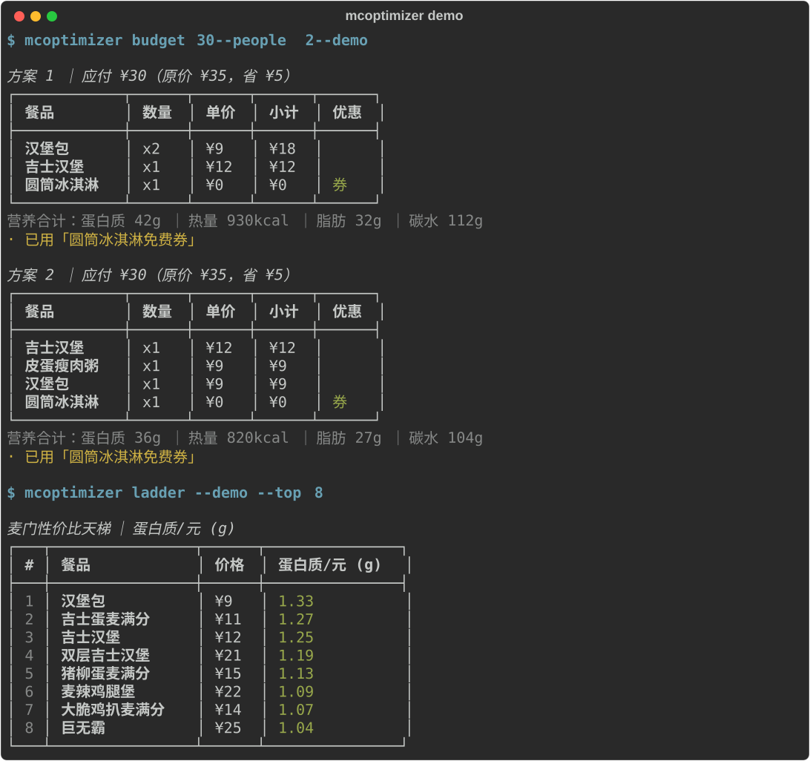

# mcoptimizer — 麦门点单最优化引擎

[](https://github.com/minilong/mcoptimizer/actions/workflows/ci.yml)
[](LICENSE)
[](pyproject.toml)

> 30 元预算在麦当劳怎么吃最值？—— 把点单变成背包问题，用真实数据求解。

基于**麦当劳官方 MCP（mcd-mcp）**实时菜单、优惠券与营养数据，用**动态规划（背包）+ 整数规划（ILP）**回答三个问题：

- 💰 **budget**：预算 30 元、2 个人，怎么点最值？
- 🥗 **nutrition**：蛋白质 ≥ 40g、热量 ≤ 800kcal，最便宜怎么点？
- 🎫 **coupon**：心愿单已定，手里的券怎么用省最多？

外加一张实时生成的 **性价比天梯**（每元蛋白质排行榜）。



## 30 秒体验（无需任何 token）

```bash
pip install -e ".[ilp]"
mcoptimizer budget 30 --people 2 --demo      # 预算最优解（背包 DP）
mcoptimizer nutrition --protein 40 --max-cal 800 --demo   # 营养约束最省钱（ILP）
mcoptimizer coupon --items "巨无霸x1,中薯条x2" --demo     # 心愿单最优用券
mcoptimizer ladder --demo                    # 性价比天梯
```

`--demo` 使用内置示例数据，全部功能离线可跑。欢迎 clone 后立刻试玩。

## 真实数据模式（麦当劳官方 MCP）

1. 按[官方指南](https://github.com/M-China/mcd-mcp-server)申请 MCP Token；
2. 设置环境变量（token 只走环境变量，CLI 故意不提供 `--token` 参数，防止泄露进 shell 历史）：

```bash
export MCD_MCP_TOKEN=你的token        # Windows: setx MCD_MCP_TOKEN 你的token
```

3. 拉取附近门店真实数据并求解：

```bash
mcoptimizer fetch --lat 31.2304 --lon 121.4737   # 拉门店/菜单/券/营养到本地缓存
mcoptimizer budget 30 --people 2
mcoptimizer coupon --items "巨无霸x1,中薯条x2,可口可乐(中)x2"
```

本地估算的方案可经 mcd-mcp `calculate-price` 权威验价，最终以门店实际结算为准。

## 它是怎么算的

| 模式 | 算法 | 说明 |
|---|---|---|
| budget | 券子集枚举 × 有界背包 DP（GCD 缩放） | 满减/满折后处理；近似 Top-K |
| nutrition | PuLP（CBC）整数规划 | 营养约束下费用最小；integer cut 严格 Top-K |
| coupon | DFS + 分支限界 | 券↔商品指派搜索，互斥规则剪枝 |
| ladder | 指标排序 | 每元蛋白质/热量/饱腹感 |

算法细节、建模假设与已知取舍（全部如实声明）见 [docs/algorithms.md](docs/algorithms.md)。
MCP 集成方式见 [MCP_INTEGRATION.md](MCP_INTEGRATION.md)。

## 输出即分享

`--md` 参数直接输出 Markdown 表格，可复制到 Issue / 社区帖：

```bash
mcoptimizer ladder --demo --md
mcoptimizer budget 50 --people 3 --demo --md
```

## 工程化

- `src/` 布局 + pydantic v2 数据模型，价格全程以「分」计算（零浮点误差）；
- pytest 37 项测试：手工可验算的最优解断言、边界（预算 0 / 无解 / 缺数据）、demo 全链路；
- ruff lint + format，GitHub Actions CI；
- 无 token、无网络也能跑通（demo 模式是一等公民）。

## 目标用户

- 想把每分钱花明白的麦门食客；
- 对「用算法解决日常问题」感兴趣的开发者；
- 想看一个 MCP Server 真实落地案例的工程师。

## 免责声明

本项目为**非官方社区项目**，与麦当劳公司无关，仅供学习研究。餐品信息、价格、
营养数据及供应状态以麦当劳官方渠道的实时结果为准；本项目输出不构成医疗、
营养或其他专业建议。示例数据（`--demo`）仅为演示，可能与实际在售情况不同。

## License

MIT
